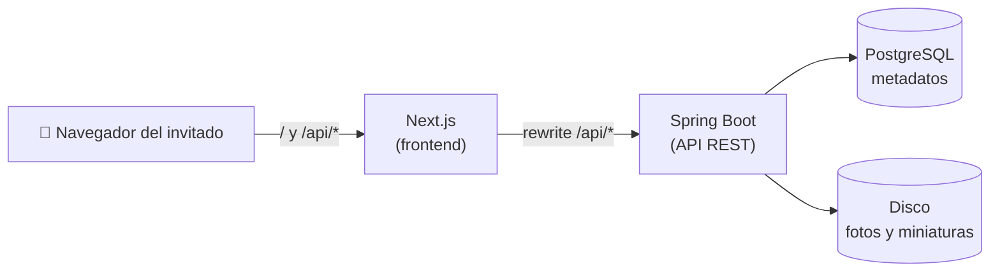

# Wedding Gallery

Álbum de fotos compartido para una boda. Los invitados escanean un código QR, suben las fotos que hacen con su móvil en calidad original, ven las de los demás y las descargan. Sin cuentas, sin instalar nada y sin fotógrafo.

Lo construí para la boda de mi madre (12 de diciembre de 2026) y como proyecto de portafolio: una API REST en **Spring Boot** y un frontend **mobile-first** en **Next.js**, trabajados con Gitflow y pull requests.

## Qué hace

- **Entrada con QR.** El QR lleva un código de acceso; la web lo cambia por una cookie segura y lo borra de la barra de direcciones.
- **Subida en calidad original**, varias fotos a la vez, con confirmación previa, barra de progreso y reintentos si se corta la conexión. También se puede hacer la foto directamente con la cámara.
- **Galería** con miniaturas generadas en el servidor y scroll infinito.
- **Vista ampliada** con gesto de deslizar, botón de compartir (en los móviles que lo admiten) y descarga del archivo original con su nombre.
- **Borrar solo las fotos propias**, sin cuentas de usuario: cada móvil tiene una identidad anónima en una cookie.
- **El nombre del invitado** se pide una vez y se recuerda en su dispositivo.

## Stack

| Capa | Tecnología |
|---|---|
| Backend | Java 25, Spring Boot 4.1 (Web MVC, Data JPA, Validation) |
| Base de datos | PostgreSQL 17 con migraciones Flyway |
| Imágenes | Thumbnailator + TwelveMonkeys (WebP) |
| Frontend | Next.js 16, React 19, TypeScript, Tailwind CSS 4 |
| Infraestructura | Docker Compose |
| Tests | JUnit 5, AssertJ |

## Arquitectura



El navegador solo habla con **un origen**: Next.js reenvía `/api/*` al backend. Así la cookie de acceso viaja sola en cada petición, incluidas las de las etiquetas ``, y no hace falta configurar CORS.

En el backend, cada capa tiene una responsabilidad:

```
controlador (HTTP)  →  servicio (reglas)  →  repositorio (BD)
                                          →  StorageService (disco)
```

`StorageService` es una interfaz: hoy guarda en disco local y mañana podría guardar en un almacenamiento de objetos sin tocar el servicio.

## Decisiones técnicas

**Archivos**
- La subida se copia al disco en *streaming*: la memoria usada no depende del tamaño de la foto (hasta 50 MB).
- El nombre en disco es un UUID; el nombre original solo se guarda como dato. Las rutas se normalizan y se comprueba que no salgan de la carpeta de fotos (protección contra *path traversal*).
- El tipo de archivo lo decide el servidor a partir de una lista blanca de extensiones, no la cabecera que envía el cliente. Junto a `X-Content-Type-Options: nosniff`, evita que se cuele un SVG o un HTML con código.
- Si una miniatura no se puede generar (por ejemplo, HEIC), la subida no falla: se sirve el original.

**Acceso y permisos**
- El código del QR se compara en tiempo constante (`MessageDigest.isEqual`) para evitar ataques por tiempo de respuesta. Si falta o tiene menos de 16 caracteres, la aplicación no arranca.
- Cookies `HttpOnly`, `Secure` y `SameSite=Lax`. Un `HandlerInterceptor` protege todo `/api/**` salvo la entrada: **denegar por defecto**.
- Para borrar, cada dispositivo recibe una cookie con un UUID aleatorio que se guarda como dueño de sus fotos. La API devuelve `mine: true/false`, nunca el identificador del dueño. La comprobación se hace en el servidor: `204` si es tuya, `403` si no.
- Al borrar, primero se elimina la fila y después los archivos: si algo falla a mitad, queda un archivo huérfano invisible en lugar de una foto rota en la galería.
- Las imágenes se sirven con `Cache-Control: private` para que ninguna caché intermedia las entregue sin la cookie.

**Datos**
- Identificadores UUID en lugar de numéricos, para que no se puedan recorrer las fotos probando ids.
- Esquema versionado con Flyway (`V1`, `V2`, `V3`) y `ddl-auto=validate`: Hibernate comprueba que la entidad y la tabla coinciden, pero nunca cambia la base de datos.
- Índice en `uploaded_at DESC` para la galería, y un tamaño de página máximo de 50 para que nadie pueda pedir todas las fotos de golpe.
- Los errores siguen el formato estándar **ProblemDetail** (RFC 9457). Los 5xx devuelven un mensaje genérico y el detalle va solo al log.

## API

| Método | Ruta | Descripción | Respuestas |
|---|---|---|---|
| `POST` | `/api/access` | Valida el código del QR y entrega las cookies | `204`, `401` |
| `GET` | `/api/photos?page=0&size=20` | Lista paginada, de la más reciente a la más antigua | `200` |
| `POST` | `/api/photos` | Sube una foto (`multipart/form-data`: `file`, `uploaderName` opcional) | `201`, `400`, `413` |
| `GET` | `/api/photos/{id}/thumbnail` | Miniatura (máx. 400 px) | `200`, `404` |
| `GET` | `/api/photos/{id}/image` | Original, para mostrar | `200`, `404` |
| `GET` | `/api/photos/{id}/download` | Original, como descarga con su nombre | `200`, `404` |
| `DELETE` | `/api/photos/{id}` | Borra una foto propia | `204`, `403`, `404` |

Todas las rutas salvo `/api/access` devuelven `401` sin la cookie de acceso.

## Estructura

```
Wedding-gallery/
├── docker-compose.yml            PostgreSQL para desarrollo
├── .env.example                  plantilla de variables
├── backend/                      API en Spring Boot
│   └── src/main/java/io/github/anismelow/weddinggallery/
│       ├── access/               código de acceso, cookies e interceptor
│       ├── photo/                entidad, repositorio, servicio y controlador
│       ├── storage/              almacenamiento de archivos
│       ├── image/                generación de miniaturas
│       ├── config/               registro del interceptor
│       └── common/               manejo global de errores
└── frontend/                     web en Next.js
    └── src/
        ├── app/                  layout, estilos y página
        ├── lib/                  cliente de la API, cola de subida, nombre
        └── components/           portada, galería, vista ampliada, subida
```

## Cómo arrancarlo en local

**Requisitos:** Java 25, Node.js 20 o superior, Docker con Docker Compose.

**1. Variables de entorno.** Copia la plantilla y rellénala:

```bash
cp .env.example .env
```

| Variable | Qué es |
|---|---|
| `POSTGRES_DB`, `POSTGRES_USER`, `POSTGRES_PASSWORD` | Credenciales de la base de datos |
| `DB_PORT` | Puerto local de PostgreSQL |
| `STORAGE_LOCATION` | Carpeta donde se guardan las fotos. Mejor una ruta absoluta |
| `ACCESS_CODE` | Código del QR. **Mínimo 16 caracteres**, o la API no arranca |

Para generar un código válido: `uuidgen | tr -d '-'` en Linux o `[guid]::NewGuid().ToString("N")` en PowerShell.

**2. Base de datos:**

```bash
docker compose up -d
```

**3. Backend** (aplica las migraciones al arrancar):

```bash
cd backend
./mvnw spring-boot:run
```

**4. Frontend**, en otra terminal:

```bash
cd frontend
npm install
npm run dev
```

**5. Abre** `http://localhost:3000/?code=<tu ACCESS_CODE>`.

## Tests

```bash
cd backend
./mvnw test
```

- `AccessServiceTest`: validación del código (correcto, incorrecto, nulo, vacío, demasiado corto).
- `LocalStorageServiceTest`: guardar, leer, borrar de forma idempotente y bloqueo de *path traversal*, usando una carpeta temporal.
- `WeddingGalleryApiApplicationTests`: arranque completo de la aplicación. Necesita la base de datos levantada y el `.env`.

## Hoja de ruta

- [ ] Despliegue con dominio propio y HTTPS
- [ ] CI con GitHub Actions (tests en cada pull request) y despliegue continuo
- [ ] Copias de seguridad diarias de fotos y base de datos
- [ ] Miniaturas para fotos HEIC de iPhone
- [ ] Descargar todo el álbum en un ZIP
- [ ] Tests de los endpoints con MockMvc
- [ ] La misma API en Django REST Framework, usando el mismo frontend

## Forma de trabajo

- **Gitflow:** `main` (producción), `develop` (integración) y una rama `feature/*` por funcionalidad.
- Cada funcionalidad entra en `develop` mediante una pull request con *squash merge*.
- Mensajes de commit con [Conventional Commits](https://www.conventionalcommits.org/) (`feat`, `fix`, `docs`, `test`…).
- Secretos fuera del repositorio: solo se versiona `.env.example`.

## Cómo se hizo

Desarrollé este proyecto con la ayuda de **Claude**, un asistente de IA de Anthropic, usándolo como tutor:

- **Backend:** lo escribí yo paso a paso. Claude me planteaba cada fase, me daba pistas y explicaciones, revisaba mi código y me señalaba los errores y los principios de diseño que rompían.
- **Frontend:** lo generó Claude a partir de mis indicaciones (diseño, flujo de subida, confirmación, borrado), y yo lo revisé, lo probé y lo integré con la API.
- **Decisiones de diseño** (seguridad, modelo de permisos, despliegue): las fuimos razonando juntos antes de implementarlas.

El objetivo era aprender a construir una API real con buenas prácticas, no solo terminarla.

## Autor

**Anyell Mendoza** · Desarrollador backend junior · [GitHub](https://github.com/Anismelow)
